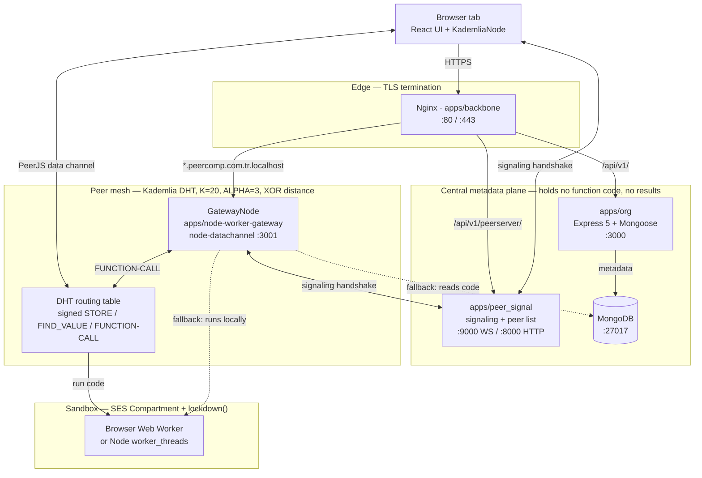

# PeerComp

**Serverless JavaScript on a Kademlia DHT over WebRTC — every browser tab is a compute node. No compute cluster, no single point of control.**

[](https://www.typescriptlang.org/)
[](https://nodejs.org/)
[](https://react.dev/)
[](https://vite.dev/)
[](https://pnpm.io/)
[](https://expressjs.com/)
[](https://www.mongodb.com/)
[](#status-and-license)

BSc graduation project · Full-stack · TypeScript monorepo

## What it is

PeerComp is a peer-to-peer platform for deploying and running **sandboxed JavaScript functions**, plus a per-user **key-value store**. Every browser tab that loads the frontend joins a Kademlia distributed hash table (DHT) as a full node. A deployed function is stored in the DHT under the key `namespace:function:<METHOD>:<endpoint>`, and any peer can execute any other peer's code inside a SES `Compartment` — a hardened object-capability sandbox with no DOM, no network primitives and no host globals.

Only two components are centralized: `apps/org`, a REST API for accounts and for function and key-value metadata, and `apps/peer_signal`, a WebRTC signaling server that also exposes the peer list. Both hold metadata in MongoDB; neither holds function code or function results. Once two peers are introduced, function discovery, invocation and state exchange happen directly between them (`apps/web/app/lib/peer/peer-node.ts`, `apps/node-worker-gateway/node.ts`).

The motivating problem is the cost of *owning* serverless infrastructure, not the cost of running code. A managed function platform concentrates billing, regions, rate limits and outages behind one provider. PeerComp moves the registry to a small API and borrows compute from the clients that already have idle CPUs: a DHT provides content-addressed lookup across a churning set of participants, and WebRTC provides a direct, NAT-traversable data channel once a signaling server introduces two browsers.

## Features

**Distributed execution**

- Browser tabs are first-class DHT nodes; no dedicated compute host is required (`apps/web/app/lib/peer/peer-node.ts`).
- Function store and lookup over a Kademlia DHT with signed writes (`STORE`, `FIND_VALUE`, `STORE_WITH_SIGNATURE`, `FUNCTION-CALL`), `K = 20` and `ALPHA = 3` over 256-bit node ids.
- Peer fan-out in groups of three with `Promise.any` racing, degrading to the next group only when all three in a group fail (`apps/node-worker-gateway/node.ts`, `apps/web/app/lib/peer/peer-node.ts`).
- Automatic fallback: if no peer answers, the gateway loads the function from MongoDB and runs it locally in a Node `worker_threads` thread through the same SES sandbox (`apps/node-worker-gateway/main.ts`).
- The same SES sandbox runs in a browser Web Worker and in a Node worker thread (`apps/web/app/lib/peer/worker.js`, `apps/node-worker-gateway/worker.mjs`, `packages/worker/index.js`).
- One subdomain per function: `<endpoint>.peercomp.com.tr.localhost` is routed straight into the gateway and then into the mesh (`apps/backbone/nginx/nginx.conf`).

**Security**

- ECDSA P-256 identity per user; the namespace is the SHA-256 digest of the SPKI public key, so the key *is* the address (`packages/encryption/utils.ts`, `IdentityKey.calculateNamespace`).
- Every DHT write is re-validated by the receiving peer: the namespace is recomputed from the owner public key and matched, and the write must carry either a direct owner signature or an owner-signed delegation token that is unexpired and whose key patterns cover the target key (`validateP2PWriteRequest`).
- Key-pattern scoping limits a delegate to a set of glob patterns (`doesKeyMatchPattern`).
- SES `Compartment` plus `lockdown({ errorTaming: "unsafe", overrideTaming: "severe" })`. Ambient authority is removed rather than filtered: `WebSocket`, `RTCPeerConnection`, `localStorage`, `indexedDB`, `window` and `document` are replaced with descriptors whose get/set throw (`packages/worker/index.js`).
- REST API authentication with a JWT bearer token (`apps/org/src/middlewares/auth/index.ts`) and bcrypt password hashing (`apps/org/src/services/user.service.ts`).
- `packages/encryption` also ships `CryptoSession` (ECDH P-256 with a signed ephemeral key, then AES-GCM-256 with a fresh 96-bit IV). It is implemented as a primitive but is not yet wired into the key-value flow.

**Platform**

- Function and key-value management panel with a code editor (`apps/web/app/pages/panel/`).
- Browser persistence: function and KV records are mirrored into IndexedDB through Dexie and hydrated from the REST API when the panel mounts (`apps/web/app/lib/dexie/dexie.ts`, `apps/web/app/components/dbToLocal.tsx`).
- Signaling server with an HTTP peer-list endpoint and an in-memory connection map (`apps/peer_signal/main.ts`, `apps/peer_signal/peer-signal.ts`).

**Engineering**

- pnpm workspaces and Turborepo; one `pnpm dev` starts the four Node services (web, org, gateway, peer_signal). The backbone (MongoDB + Nginx) runs through Docker Compose.
- Shared workspace packages: `@peercomp/config`, `@peercomp/models`, `@peercomp/encryption`, `@peercomp/worker`.
- Nginx host-based routing with a locally generated PKI for secure-context development.
- TypeScript (strict) across the apps and packages, with JavaScript for the SES entrypoints; 27 technical wiki pages and a structured memory bank.

## Tech stack

| Layer | Choice |
| --- | --- |
| Language | TypeScript 5.9 (strict) for apps and packages; JavaScript for the SES entrypoints (`packages/worker/index.js`, `apps/web/app/lib/peer/worker.js`, `apps/node-worker-gateway/worker.mjs`) |
| Runtime | Node.js >= 20 |
| Monorepo | pnpm 10.33 workspaces + Turborepo 2.9 |
| Frontend | React 19.2, React Router 7.14, Vite 8, Tailwind CSS 4.2, DaisyUI 5.5, Zustand 5, Dexie 4.4 |
| Backend | Express 5.2, Mongoose 9.6, Zod 4.4, bcrypt 6, jsonwebtoken |
| P2P transport | WebRTC data channels — PeerJS 1.5.5 (browser + signaling), node-datachannel 0.32.3 (gateway) |
| DHT | Custom Kademlia implementation (`K = 20`, `ALPHA = 3`, XOR distance over 256-bit ids) |
| Crypto | Web Crypto API — ECDSA P-256, ECDH P-256, AES-GCM-256, SHA-256 |
| Sandbox | SES (`ses` 2.1.0) `Compartment` + `lockdown()`; `quickjs-emscripten` is a dependency |
| Local persistence | IndexedDB via Dexie |
| Routing / TLS | Nginx reverse proxy; a locally generated root CA and wildcard certificate |
| Infrastructure | Docker Compose (MongoDB, Nginx) |
| Intermediary data | A Redis 5 client is defined in `apps/peer_signal/redis.ts` but is not imported anywhere; the Redis service is commented out in `apps/backbone/docker-compose.yaml` |

## Architecture

```
                                 https://peercomp.com.tr.localhost
                                            │
                                    ┌───────▼────────┐
                                    │  Nginx  :80/:443│   TLS termination
                                    │  (backbone)     │   host-based routing
                                    └───┬────┬────┬───┘
              ┌─────────────────────────┘    │    └──────────────────┐
              │                              │                       │
              │ /api/v1/                     │ /api/v1/peerserver/   │ *.peercomp.com.tr.localhost
              ▼                              ▼                       ▼
    ┌───────────────────┐        ┌────────────────────┐    ┌──────────────────────────┐
    │  apps/org         │        │  apps/peer_signal  │    │ apps/node-worker-gateway │
    │  Express 5 +      │        │  PeerJS signaling  │    │ GatewayNode (HTTP → P2P) │
    │  Mongoose :3000   │        │  WS :9000          │    │ node-datachannel :3001   │
    └─────────┬─────────┘        │  peer list :8000   │    └────────────┬─────────────┘
              │                  └─────────┬──────────┘                 │
              ▼                            │                            │
      ┌───────────────┐                    │                            │
      │   MongoDB     │◄───────────────────┘                WebRTC DataChannel
      │   :27017      │                                    (node-datachannel ↔ PeerJS)
      │  docker       │                                            │
      └───────────────┘                                            │
                                                                 ▼
   ┌───────────────────────────────────────────────────────────────────────────┐
   │  PEER MESH  —  Kademlia DHT, K=20, ALPHA=3, XOR distance over 256-bit IDs  │
   │                                                                           │
   │  ┌──────────────┐  ┌──────────────┐  ┌──────────────┐  ┌──────────────┐  │
   │  │ Browser Tab A│  │ Browser Tab B│  │ Browser Tab C│  │ GatewayNode  │  │
   │  │ KademliaNode │◄►│ KademliaNode │◄►│ KademliaNode │◄►│ DHT member   │  │
   │  │  + Dexie/IDB │  │  + Dexie/IDB │  │  + Dexie/IDB │  │              │  │
   │  └──────┬───────┘  └──────┬───────┘  └──────┬───────┘  └──────────────┘  │
   │         │                 │                 │                             │
   │    ┌────▼────┐       ┌────▼────┐       ┌────▼────┐                        │
   │    │  SES    │       │  SES    │       │  SES    │   sandboxed execution  │
   │    │Compart. │       │Compart. │       │Compart. │   (Compartment +        │
   │    │WebWorker│       │WebWorker│       │WebWorker│    lockdown())           │
   │    └─────────┘       └─────────┘       └─────────┘                        │
   └───────────────────────────────────────────────────────────────────────────┘
```



Three planes, and it matters which is which:

| Plane | Components | Role |
| --- | --- | --- |
| **Edge** | Nginx (`apps/backbone`) | Terminates TLS, routes by host and path. The only public entry point. |
| **Metadata plane** | `apps/org`, MongoDB, `apps/peer_signal` | Accounts, function metadata, bootstrap handshake, peer list. Deliberately small — it holds no function code and no function results. |
| **Peer mesh** | Browser `KademliaNode`s + `GatewayNode` | Function storage, discovery and **execution**. Scales with the users, not with a cluster. |

Nginx routing, from `apps/backbone/nginx/nginx.conf`:

| Request | Upstream | Port |
| --- | --- | --- |
| `/` | Vite dev server (`apps/web`) | 5173 |
| `/api/v1/` | `apps/org` (Nginx rewrites the prefix to `/api/`) | 3000 |
| `/api/v1/peerserver/` | `apps/peer_signal` (PeerJS signaling WS) | 9000 |
| `/api/v1/peers/` | `apps/peer_signal` (peer list) | 8000 |
| `/api/v1/database/mongo/` | MongoDB | 27017 |
| `*.peercomp.com.tr.localhost` | `apps/node-worker-gateway` | 3001 |

That last row is the idea in one line: every deployed function gets its own subdomain, and host routing dispatches it straight into the P2P mesh.

### How a function is deployed and invoked

1. **Register.** The client `POST`s the function (name, endpoint, HTTP method, source, namespace) to `apps/org` with a JWT. `FunctionModel` persists it to MongoDB. A unique compound index on `(endpoint, method, metadata.namespace)` prevents a silent collision (`packages/models/src/function.model.ts`).

2. **Announce.** The client signs the deployment payload with its ECDSA identity and pushes it into the DHT with `STORE_WITH_SIGNATURE`, keyed `` `${namespace}:function:${method}:${endpoint}` `` (`apps/web/app/pages/panel/components/newFuncModal.tsx`). Routing hashes the key with SHA-256 against a 256-bit node-id space, with `K = 20` per k-bucket and `ALPHA = 3` concurrent queries.

3. **Verify.** Every peer that receives `STORE_WITH_SIGNATURE` calls `validateP2PWriteRequest` *before* accepting the write. It recomputes the namespace from the owner's SPKI public key, checks that it matches the claimed namespace, then accepts either a direct owner signature or an owner-signed delegation token that is unexpired and whose key patterns cover the target key. A peer that does not agree rejects the write (`apps/web/app/lib/peer/peer-node.ts`, `packages/encryption/utils.ts`).

4. **Route.** The caller sends an ordinary HTTP request to `https://<endpoint>.peercomp.com.tr.localhost`. Nginx matches the wildcard `server_name`, strips the subdomain into an `X-Subdomain` header, and proxies to `GatewayNode` on `:3001`.

5. **Locate.** `GatewayNode.call_function` derives the namespace from the `x-targetnamespace` header, rebuilds the DHT key, and sorts its known peers by XOR distance to the hashed key. It walks the sorted list in groups of `CHUNK_SIZE = 3` and races each group with `Promise.any`; the first success wins and no further group is contacted (`apps/node-worker-gateway/node.ts`).

6. **Invoke.** The winning peer receives a `FUNCTION-CALL` RPC, resolves the key with `findValue`, and spawns a worker running the function's code. Timeouts are enforced by the callers, not by the sandbox: `GatewayNode._sendRPC` gives up after 4s, and the browser-side `FUNCTION-CALL` handler terminates the worker after 5s. Both worker entrypoints also destructure a `timeout = 15000` field from the message payload, but neither currently acts on it (`apps/node-worker-gateway/node.ts`, `apps/web/app/lib/peer/peer-node.ts`, `worker.mjs`, `worker.js`).

7. **Fallback.** If every peer group fails, `GatewayNode` loads the function from MongoDB and executes it locally in a Node `worker_threads` thread through the same SES sandbox. The response is tagged `system: true`, so the caller can tell which path ran (`apps/node-worker-gateway/main.ts`).

### Security model

| Concern | Mechanism | Where |
| --- | --- | --- |
| Identity | ECDSA P-256 keypair per user; namespace id is the SHA-256 digest of the SPKI public key, so the key *is* the address | `packages/encryption/utils.ts` (`IdentityKey`) |
| Transport | TLS terminated at Nginx. The certificate and key are generated locally and are not committed; only `openssl.cnf` is in the repository | `apps/backbone/nginx/nginx.conf`, `apps/backbone/nginx/certs/openssl.cnf` |
| Key agreement | ECDH P-256; the ephemeral key is signed by the identity key, so a MITM cannot substitute it. Implemented as a primitive but not yet used by the KV flow | `packages/encryption/utils.ts` (`CryptoSession`) |
| Bulk encryption | AES-GCM-256 with a fresh 96-bit IV per message. Implemented as a primitive but not yet used by the KV flow | `packages/encryption/utils.ts` (`CryptoSession`) |
| DHT write authorization | Owner signature, or an owner-signed delegation token whose expiry and key-pattern scope are checked on **every** write | `packages/encryption/utils.ts` (`validateP2PWriteRequest`) |
| Key-pattern scoping | `doesKeyMatchPattern` limits a delegate to a set of glob key patterns | `packages/encryption/utils.ts` |
| Untrusted code | SES `Compartment` + `lockdown({ errorTaming: "unsafe", overrideTaming: "severe" })`; intrinsics frozen | `apps/node-worker-gateway/worker.mjs`, `apps/web/app/lib/peer/worker.js` |
| Capability removal | `WebSocket`, `RTCPeerConnection`, `localStorage`, `indexedDB`, `window` and `document` are replaced with descriptors whose get/set **throw** `SecurityError` | `packages/worker/index.js` |
| Runaway code | Caller-side wall clock: the gateway abandons a peer RPC after 4s, and the browser-side `FUNCTION-CALL` handler calls `worker.terminate()` after 5s | `apps/node-worker-gateway/node.ts`, `apps/web/app/lib/peer/peer-node.ts` |
| SSRF from sandbox | `isPrivateOrInvalidIP` blocks `localhost`, loopback, RFC1918 (`10/8`, `172.16/12`, `192.168/16`), link-local, broadcast and IPv6 private/ULA ranges before a request leaves the sandbox — **but see Known issues** | `apps/web/app/lib/peer/worker.js` |
| Password storage | bcrypt | `apps/org/src/services/user.service.ts` |
| API authentication | A single JWT bearer token (7-day expiry) sent as `Authorization: Bearer <token>` | `apps/org/src/middlewares/auth/index.ts`, `apps/org/src/services/user.service.ts` |

### Repository layout

```
peercomp/
├── apps/
│   ├── web/                        React Router 7 SPA + browser KademliaNode
│   │   └── app/
│   │       ├── components/         Panel UI, function/KV editors, root P2P mount
│   │       ├── lib/
│   │       │   ├── dexie/          IndexedDB schema (dexie.ts)
│   │       │   ├── peer/           peer-node.ts (DHT), worker.js (SES)
│   │       │   └── store/          Zustand state
│   │       ├── pages/              Landing, auth, panel
│   │       └── root.tsx            Mounts the root P2P node
│   ├── org/                        Express 5 REST API + Mongoose        :3000
│   │   └── src/{routes,controller,services,middlewares}
│   ├── node-worker-gateway/        HTTP → P2P bridge (GatewayNode)      :3001
│   │   ├── main.ts  node.ts  worker.mjs
│   ├── peer_signal/                WebRTC signaling and peer list       :9000 / :8000
│   └── backbone/                   Nginx + MongoDB + local PKI
│       ├── docker-compose.yaml
│       └── nginx/{nginx.conf,certs/openssl.cnf}
├── packages/
│   ├── config/                     Centralized API endpoints (api.json)
│   ├── models/                     Mongoose schemas (user, function, kv)
│   ├── encryption/                 IdentityKey, CryptoSession, validateP2PWriteRequest
│   └── worker/                     SES Compartment runner
├── wiki/                           27 technical pages
├── memory-bank/                    Structured project memory (see AGENTS.md)
├── Ön Rapor/rapor.md               Graduation pre-report (Turkish)
└── AGENTS.md
```

## Getting started

PeerComp runs as a pnpm/Turborepo monorepo plus a Docker Compose backbone. There is no hosted deployment; everything below is local development.

### Local development

#### Prerequisites

- **Node.js >= 20**
- **pnpm** (`corepack enable pnpm` is fine)
- **Docker + Docker Compose**
- **OpenSSL** on the command line, to generate the local TLS certificates
- A browser with WebRTC and Web Crypto. Both require a **secure context**, which is why this setup is HTTPS rather than plain localhost.

#### 1. Install dependencies

```bash
pnpm install
```

#### 2. Create the `.env` files

Two applications read a local `.env` file (each with `dotenv.config()` from its own directory). Copy the examples and fill them in:

```bash
cp apps/org/.env.example apps/org/.env
cp apps/node-worker-gateway/.env.example apps/node-worker-gateway/.env
```

No `.env` file is committed to the repository; they are local-only. Do not commit them.

#### 3. Replace the `[REDACTED_LOCAL_DEV_*]` placeholders with your own local values

The two Compose files and two source files still contain `[REDACTED_LOCAL_DEV_USER]` and `[REDACTED_LOCAL_DEV_PASSWORD]` placeholders. These are not usable credentials; replace them with values of your own:

- In `apps/backbone/docker-compose.yaml`, set `MONGO_INITDB_ROOT_USERNAME` and `MONGO_INITDB_ROOT_PASSWORD`. (The same placeholders appear in the commented-out Redis service; leave that service disabled.)
- Use the **same** username and password in the `MONGODB_URI` of both `apps/org/.env` and `apps/node-worker-gateway/.env`.

```yaml
# apps/backbone/docker-compose.yaml (edit these two lines)
MONGO_INITDB_ROOT_USERNAME: <your-local-mongo-user>
MONGO_INITDB_ROOT_PASSWORD: <your-local-mongo-password>
```

```env
# apps/org/.env and apps/node-worker-gateway/.env
MONGODB_URI=mongodb://<your-local-mongo-user>:<your-local-mongo-password>@localhost:27017/peercomp?authSource=admin
```

#### 4. Regenerate the local TLS certificates

Nginx serves TLS from `/etc/nginx/certs/cert.pem` and `/etc/nginx/certs/key.pem` (`apps/backbone/nginx/nginx.conf`), mapped from `apps/backbone/nginx/certs/`. The certificate, the key and the root CA are **not** in the repository; only `openssl.cnf` is, and it defines the SAN list (`peercomp.com.tr.localhost` and `*.peercomp.com.tr.localhost`). Generate them locally:

```bash
cd apps/backbone/nginx/certs

# 1. Local root CA (trust this once)
openssl req -x509 -newkey rsa:2048 -nodes -sha256 -days 3650 \
  -keyout rootCA.key -out rootCA.pem \
  -subj "/CN=PeerComp Local Development Root CA" \
  -addext "basicConstraints=critical,CA:TRUE" \
  -addext "keyUsage=critical,keyCertSign,cRLSign"

# 2. Leaf key and CSR, carrying the SAN list from the committed openssl.cnf
openssl req -newkey rsa:2048 -nodes -sha256 \
  -keyout key.pem -out cert.csr -config openssl.cnf

# 3. Sign the leaf with the root CA
openssl x509 -req -in cert.csr -CA rootCA.pem -CAkey rootCA.key -CAcreateserial \
  -out cert.pem -days 825 -sha256 -extfile openssl.cnf -extensions req_ext

cd ../../..
```

This creates `apps/backbone/nginx/certs/{rootCA.pem,rootCA.key,cert.pem,key.pem}`. These files are local-only; do not commit them.

#### 5. Trust the root CA

Import `apps/backbone/nginx/certs/rootCA.pem` into your OS and browser trust store, or every WebRTC and Web Crypto call fails on an insecure context.

```bash
# macOS
sudo security add-trusted-cert -d -r trustRoot \
  -k /Library/Keychains/System.keychain \
  apps/backbone/nginx/certs/rootCA.pem

# Linux (Debian/Ubuntu)
sudo cp apps/backbone/nginx/certs/rootCA.pem \
  /usr/local/share/ca-certificates/peercomp-rootCA.crt
sudo update-ca-certificates
```

#### 6. Map the dev domain

```text
# /etc/hosts  (sudo on Linux/macOS; edit as Administrator on Windows)
127.0.0.1 peercomp.com.tr.localhost
```

The wildcard certificate and the Nginx `server_name` cover `*.peercomp.com.tr.localhost`, and each function is served from its own subdomain.

#### 7. Start the backbone (MongoDB + Nginx)

```bash
docker volume create org_peercomp_data   # apps/backbone/docker-compose.yaml expects this external volume
docker compose -f apps/backbone/docker-compose.yaml up -d
```

This starts MongoDB on `:27017` and Nginx on `:80` / `:443`. The `ngi` service runs with `network_mode: host` and proxies to the host's `127.0.0.1` ports, so the Node services below must run on the host. (`apps/org/docker-compose.yaml` is an alternative that creates its own `peercomp_data` volume and starts Redis instead of Nginx; it is not needed for the steps here.)

#### 8. Start the services

```bash
pnpm dev          # turbo dev — runs the dev task in web, org, node-worker-gateway and peer_signal
```

Or start one at a time from the repository root:

```bash
pnpm --filter web dev                 # apps/web            :5173
pnpm --filter org dev                 # apps/org            :3000
pnpm --filter node-worker-gateway dev # gateway             :3001
pnpm --filter peer_signal dev         # signaling     :9000 (WS) / :8000 (peers)
```

#### 9. Open the app

Open **`https://peercomp.com.tr.localhost`**. The lock icon must be clean; a TLS warning means the CA is not trusted and crypto will not initialize.

## Usage example

A short end-to-end walkthrough using the panel and one `curl`.

1. **Open two browser tabs** at `https://peercomp.com.tr.localhost`. Each tab creates a `KademliaNode` and connects to the signaling server (`apps/web/app/components/peerComponent.tsx`).

2. **Register** an account in tab A (name, surname, username, e-mail, password). Registration creates the user and returns a JWT (`POST /api/v1/users/create` → `apps/org/src/services/user.service.ts`). Passwords must be at least 8 characters and contain an upper-case letter, a lower-case letter, a digit and a special character.

3. **Create an identity keypair.** Go to **Panel → Settings** and click **Generate Key Pair**. This generates an ECDSA P-256 keypair in the browser and persists it to the API with `POST /api/v1/users/update-keypair` (`apps/web/app/pages/panel/settings.tsx`). The keypair is *not* created at registration, and creating a function is blocked until it exists.

4. **Register a second account** in tab B. Both tabs now appear in the peer list; the panel reports the connected peer count once the WebRTC handshake completes.

5. **Create a function** in tab A. Use the function editor with:
   - Endpoint: `hello`
   - Method: `POST`
   - Body:

     ```js
     return "hi from " + args[0];
     ```

   The function is signed and announced into the DHT and saved to MongoDB (`POST /api/v1/functions/create`).

6. **Call it.** The gateway takes the target namespace from the `x-targetnamespace` header as the owner's base64 SPKI public key (the `publicKey` field of the identity keypair file you can download from Settings), rebuilds the DHT key and dispatches the call:

   ```bash
   curl -X POST https://hello.peercomp.com.tr.localhost \
     -H 'Content-Type: application/json' \
     -H 'x-targetnamespace: <your base64 SPKI publicKey>' \
     -d '{"args":["peer"]}'
   ```

   When a peer answers, the response is the function's result:

   ```json
   { "code": 200, "message": "OK", "error": false, "data": "hi from peer" }
   ```

7. **Read the response.** If the body carries `"system": true`, no peer answered and the gateway executed the function from MongoDB in a local worker thread instead (`apps/node-worker-gateway/main.ts`). Both paths are correct behavior; the second one is the fallback working.

## Status and license

This is a graduation project and it is not finished. What follows is the state of it, including the parts that do not work yet.

### Working

- `apps/org` REST API: users, functions, KV CRUD, JWT auth, Zod validation
- Browser `KademliaNode`: k-buckets, iterative lookup, the RPC set, signed writes
- SES sandbox in both a browser Web Worker and a Node worker thread, with ambient-authority removal
- `validateP2PWriteRequest`: namespace binding, owner signatures, expiring scoped delegation tokens
- `GatewayNode`: HTTP → P2P invocation, group-of-3 fan-out, MongoDB → local-worker fallback
- Nginx host-based routing and TLS termination with a locally generated PKI

### Known issues

| Issue | Detail |
| --- | --- |
| **No automated tests** | No test runner is configured. `packages/encryption/test.ts` is a manual demo script, not a suite. |
| **No CI** | There is no `.github/` directory. Builds are manual. |
| **SSRF guard not in scope in `packages/worker`** | `isPrivateOrInvalidIP` is defined in `apps/web/app/lib/peer/worker.js` but is *called* from `packages/worker/index.js`, where it is not defined. Sandboxed `fetch` therefore throws `ReferenceError` instead of being guarded — it is broken rather than blocked. |
| **Sandbox KV SDK never injected** | `kvPermission` is passed to the gateway by the panel, but `apps/node-worker-gateway/main.ts` does not forward it to the worker thread and `worker.mjs` calls `runUserCodeInSES(code, args)` without it. Functions cannot touch the key-value store from inside the sandbox. |
| **No persistent peer identity** | PeerJS assigns an ephemeral peer id per session, and `GatewayNode.id` is a hardcoded constant (`apps/node-worker-gateway/node.ts`). A browser restart means a new identity. |
| **No TURN server** | STUN only (`stun.l.google.com`). Symmetric NATs are unreachable. |
| **Redis wired but not deployed** | The client in `apps/peer_signal/redis.ts` is never imported, and the Redis service is commented out in `apps/backbone/docker-compose.yaml`. |
| **KV encryption not end-to-end** | `KVModel` has `isEncrypted`/`encrypted`/`iv` fields, but the panel sends only the `isEncrypted` flag and the value in clear. `CryptoSession` is not called anywhere. |
| **`apps/web/Dockerfile` is broken** | It runs `npm ci` against a `package-lock.json` that does not exist in this pnpm workspace. The web image does not build as written. |
| **Production TLS** | Let's Encrypt automation is not implemented; the dev certificate is self-signed and generated locally. |
| **Observability** | `console.log` only. No structured logging, health checks or metrics. |

### Not implemented

- Function versioning and rollback
- Execution logs and metrics
- Scheduled / cron functions
- Function composition (chaining)
- True P2P KV replication (only the MongoDB → IndexedDB mirror exists today)
- Peer reputation and scoring
- An incentive layer for peer participation
- CI/CD and load testing

### License

MIT © 2026 Umut Can Akçay. See [LICENSE](LICENSE).
